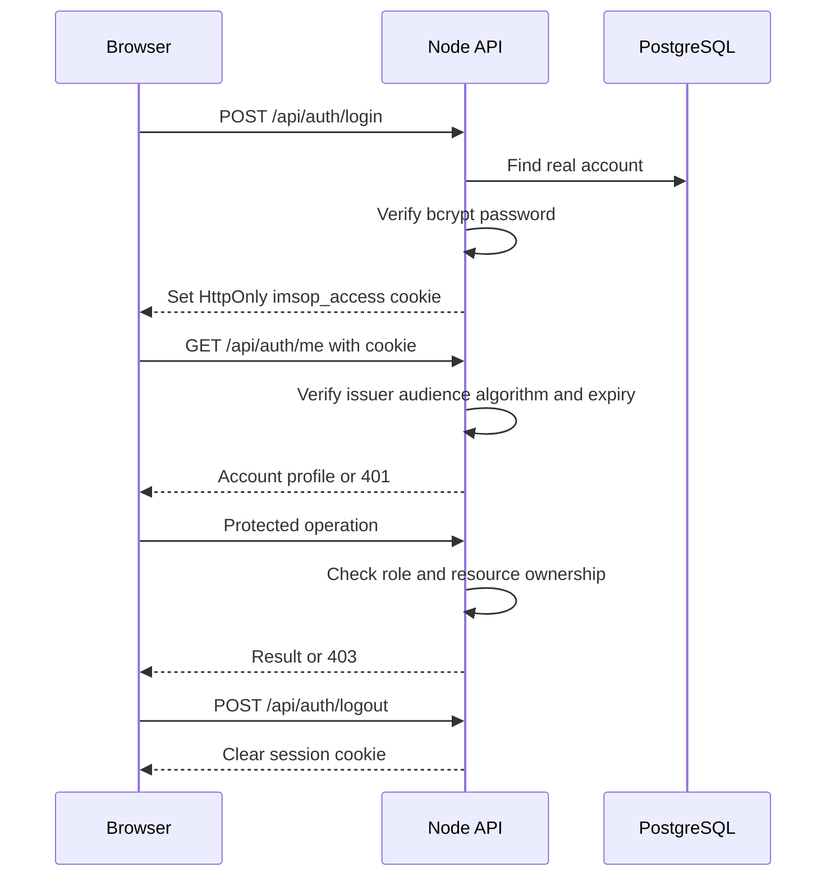
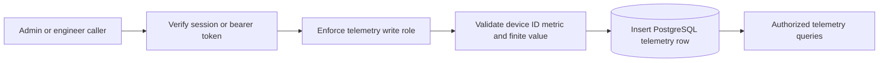
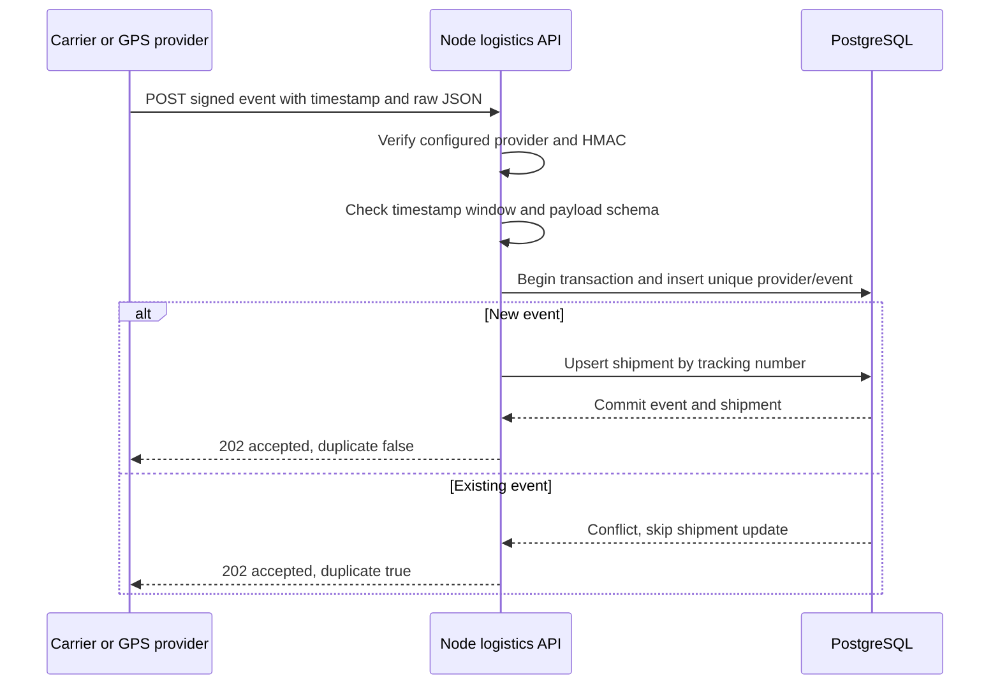

# IMSOP API Flows

The React application uses the Node REST API for accounts, operations, telemetry, and reports. The .NET Supply Chain API exposes a separate protected purchase-order path. Paths below are relative to the configured API origin; use the Vercel same-origin proxy in the hosted UI.

## Session lifecycle



The production cookie is HttpOnly, Secure, and SameSite=None; development uses SameSite=Lax. Cookie-authenticated unsafe requests must carry an exact allowed Origin unless a bearer authorization header is used. The API also supports bearer authentication for appropriate callers. Password-reset tokens cannot authenticate ordinary requests. The frontend mock-auth adapter is a separate demonstration mode.

## Authentication endpoints

| Method | Path | Access / purpose |
| --- | --- | --- |
| POST | `/api/auth/login` | Public, rate-limited credential check |
| POST | `/api/auth/register` | Public, rate-limited registration subject to server policy |
| GET | `/api/auth/me` | Signed-in account |
| POST | `/api/auth/logout` | Session termination |
| POST | `/api/auth/request-reset` | Rate-limited reset request |
| POST | `/api/auth/reset-password` | Expiring reset token and new password |
| PATCH | `/api/auth/profile/{id}` | Same-account profile update |
| POST | `/api/auth/change-password/{id}` | Same account; current password required |

Real-account passwords must satisfy the API's 12–128 character validation. Reset links expire after 15 minutes. Completing a reset increments `password_reset_version`, invalidating earlier reset links. Reset versioning is not a claim that every previously issued access token is immediately revoked.

## Operations, telemetry, and reports

| Method | Endpoint | Permitted roles |
| --- | --- | --- |
| GET | `/api/operations/shipments` | admin, engineer, analyst, user |
| GET | `/api/operations/orders` | admin, engineer, analyst |
| GET | `/api/operations/shipments/export/report` | admin, analyst |
| GET | `/api/operations/orders/export/report` | admin, analyst |
| GET | `/api/telemetry` | admin, engineer, analyst |
| POST | `/api/telemetry` | admin, engineer |
| POST | `/supply-chain/api/v1/orders` | admin, engineer, analyst; .NET purchase-order API through the gateway |
| GET | `/supply-chain/api/v1/orders/{id}` | admin, engineer, analyst; .NET purchase-order API through the gateway |

The gateway removes the `/supply-chain` prefix before forwarding to Supply Chain. Direct private-service requests use `/api/v1/orders`; that unprefixed path on the public gateway routes to Node instead.

### Telemetry ingestion



```json
{"deviceId":"sensor-42","metricName":"temperature","metricValue":22.5}
```

Device and metric names must be non-empty and at most 100 characters. The metric value must be finite. The API supplies the stored timestamp. Unlike signed logistics events, this endpoint has no documented provider/event deduplication key; callers should account for retry duplicates.

## Signed logistics provider flow



Endpoint: `POST /api/integrations/logistics/{provider}/events`.

Headers: `X-IMSOP-Timestamp` (Unix seconds) and `X-IMSOP-Signature` (`sha256=` followed by the hexadecimal HMAC). Sign `timestamp + "." + rawBody` with the provider's private signing secret. Sign the exact transmitted bytes; reformatting JSON changes the signature. The signature window is five minutes. Use UTC event timestamps and stable provider event IDs.

```json
{
  "eventId": "evt-example-001",
  "eventType": "shipment.location",
  "trackingNumber": "SHP-EXAMPLE-001",
  "status": "in_transit",
  "occurredAt": "2026-10-21T10:00:00.000Z",
  "origin": "Hamburg",
  "destination": "Berlin",
  "carrier": "Example Carrier",
  "transportMode": "road",
  "location": {"latitude": 52.52, "longitude": 13.405, "label": "Berlin"}
}
```

## Errors and operational checks

Treat `401` as a missing or invalid session, `403` as an authorization denial, and validation errors as requests to correct rather than retry unchanged. A duplicate provider event is an accepted `202` response. On transient delivery failures, preserve the event ID when retrying. Report upstream failures clearly rather than substituting fabricated records.

`GET /health` reports liveness; `GET /ready` tests database readiness. Neither alone verifies provider delivery, email, mapping, all permissions, or the end-to-end frontend proxy. Release checks should cover both permitted and denied roles, operations reads, exports, and logout.

## Source references

- [Backend API reference](https://github.com/DruHustle/imsop-app-backend/blob/main/docs/API.md)
- [Route source](https://github.com/DruHustle/imsop-app-backend/tree/main/server/src/routes)
- [Architecture](architecture.md) and [database model](database-schema.md)

Source review: 21 October 2026. Examples use synthetic records.
