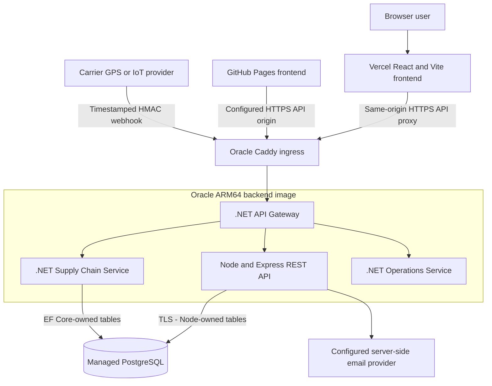

# IMSOP System Architecture

IMSOP (Intelligent Multi-Cloud Supply Chain & Operations Platform) brings shipment visibility, orders, telemetry, mapping, and reports into a React workspace. This reference separates the browser-facing Node API from the companion .NET service model and describes the current Oracle deployment.

## Runtime and hosting

Vercel serves the static frontend and proxies `/api/*` to the Oracle API. GitHub Pages uses an explicitly configured HTTPS backend origin. One ARM64 backend image contains the gateway, Node API, Operations service, and Supply Chain service. Internal service ports stay private behind Caddy. The backend and frontend release independently.

## Repository and service ownership

| Boundary | Responsibility | Source |
| --- | --- | --- |
| Frontend | React/Vite UI, authentication adapters, API-origin resolution, mapping, charts, exports, and browser tests | `imsop-app-frontend` |
| Node REST API | Real-account authentication, shipments, orders, telemetry, signed provider events, and reports | Backend `server/` |
| .NET gateway | Unified ingress and routing for the service bundle | Backend `src/IMSOP.Gateway/` |
| Supply Chain service | Protected purchase-order APIs and the EF Core supply-chain domain | Backend `src/IMSOP.SupplyChainService/` |
| Operations service | Companion operations service foundation | Backend `src/IMSOP.OperationsService/` |
| PostgreSQL | Node operational tables and separately migrated EF Core entities | Node SQL migrations and EF Core migrations |

The React application's operational flows use Node REST endpoints. GraphQL, SignalR, Azure Service Bus, and cloud infrastructure templates belong to the companion service model or optional integrations; their presence in source is not evidence that every path is active in the hosted application.

## Identity and authorization

Real accounts use bcrypt password verification and a short-lived JWT in the `imsop_access` HttpOnly cookie. The API validates the HS256 algorithm, issuer `imsop-api`, audience `imsop-web`, and expiry. Protected routes enforce roles on the server. Profile and password changes also enforce account ownership. Password-reset tokens have a separate purpose and a version that changes when a reset succeeds.

Demo identities use a separate frontend mock-auth adapter and browser storage. A successful demo session does not establish access to backend records. Production acceptance should exercise a real authorized test account separately from demonstration workflows.

| Capability | Admin | Engineer | Analyst | User |
| --- | --- | --- | --- | --- |
| Shipment reads | Yes | Yes | Yes | Yes |
| Operational order reads | Yes | Yes | Yes | No |
| Telemetry reads | Yes | Yes | Yes | No |
| Telemetry writes | Yes | Yes | No | No |
| Shipment and order report exports | Yes | No | Yes | No |
| .NET purchase-order APIs | Yes | Yes | Yes | No |

## Integration and data consistency

Provider webhooks are timestamped and signed over the exact raw request bytes. A unique `(provider, event_id)` key suppresses replayed events. Event insertion and the shipment upsert execute in one PostgreSQL transaction. The event's tracking number associates it with a shipment; it is not a declared database foreign key.

The Node telemetry API records a device ID, metric name, numeric value, and server timestamp. It is a REST ingestion path. MQTT intake, AAS asset models, edge commissioning, and industrial actuation are Smart Factory IoT capabilities and are not inferred for IMSOP.

## Availability and operating boundaries

`GET /health` reports process liveness and `GET /ready` checks database readiness. Check both through the actual ingress after releases. A shared VM is one host failure domain; container separation does not establish high availability. No availability percentage, latency target, or backup retention is asserted here without deployment evidence.

PostgreSQL credentials, JWT signing keys, email credentials, and logistics signing secrets stay in protected backend configuration. Browser builds contain only public routing configuration and a restricted Maps browser key when mapping is enabled.

## Read next

- [Database schema](database-schema.md): actual Node entities, EF Core ownership, migrations, and data integrity.
- [API flows](api-flows.md): sessions, endpoints, signed integrations, and failure responses.
- [Deployment guide](deployment.md): visual release and recovery sequence.
- [System diagrams](system-diagrams.md): identity, integration, and service boundaries.

## Source references

Reviewed against backend source and current Oracle runbooks on 21 October 2026. Historical README sections still mention MySQL and Render; the current PostgreSQL models and Oracle runbook take precedence for this guide.

- [Backend source](https://github.com/DruHustle/imsop-app-backend)
- [Database guide](https://github.com/DruHustle/imsop-app-backend/blob/main/docs/DATABASE.md)
- [Oracle deployment runbook](https://github.com/DruHustle/imsop-app-backend/blob/main/deploy/oracle/README.md)
- [Frontend source](https://github.com/DruHustle/imsop-app-frontend)
