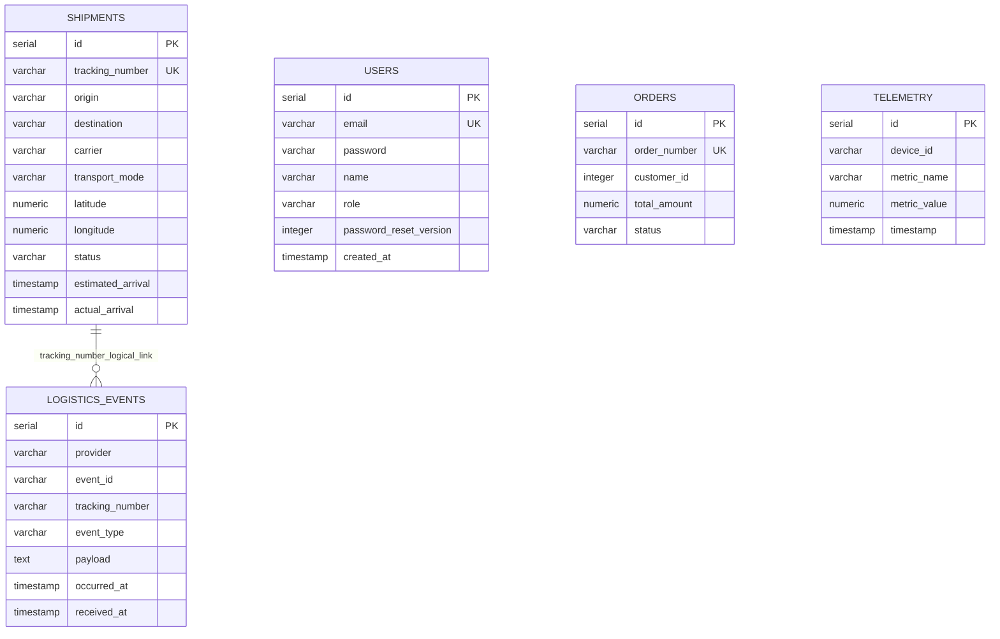
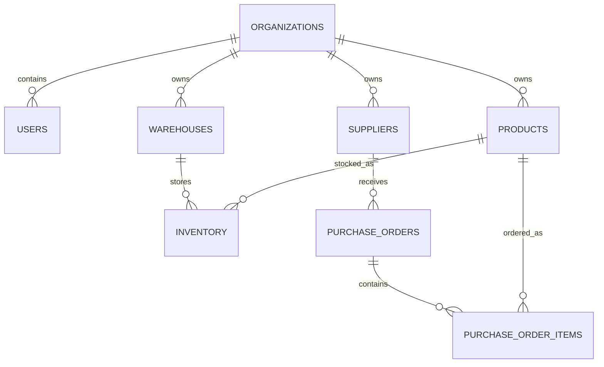
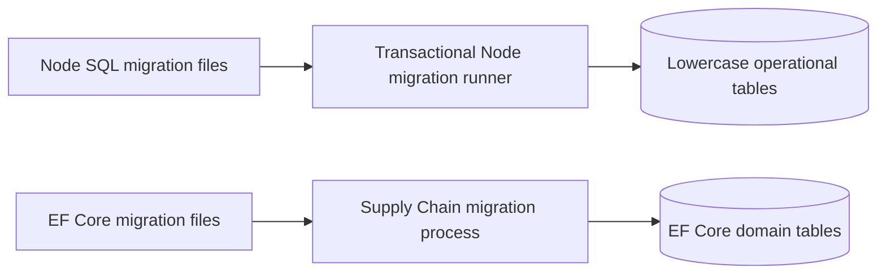

# IMSOP Database Schema

IMSOP uses PostgreSQL. The Node API owns lowercase operational tables through SQL migrations; the .NET Supply Chain service owns its separate EF Core model. This document describes source models, not a live database inspection or an executable schema dump.

## Node operational model

The shipment/event connector represents application matching by tracking number. The Node schema does not declare that relationship as a foreign key. `orders.customer_id` is also not a declared user or organization foreign key; do not invent tenant or customer relationships from its name.

| Table | Purpose | Integrity and interpretation |
| --- | --- | --- |
| `users` | Real-account identity, hashed password, role, reset version | Unique email; never export password hashes or reset material into reports |
| `shipments` | Latest operational shipment state and location | Unique tracking number; coordinates use `numeric(9,6)`; optional location may be absent |
| `logistics_events` | Original provider events and ingestion audit | Unique provider/event pair; event time and receipt time are separate |
| `orders` | Operational order summaries | Unique order number; total uses `numeric(10,2)` |
| `telemetry` | Device/metric observations | Value uses `numeric(10,2)`; server supplies the storage timestamp |

The Node schema does not establish organization-scoped row-level security or a full warehouse/inventory model. Those concepts belong to the companion .NET model and must not be presented as deployed Node tenancy guarantees.

## .NET supply-chain model

EF Core owns organizations, domain users, suppliers, products, warehouses, inventory, purchase orders, and their items. These domain entities are distinct from Node account and operational summary tables. Do not merge or rename them during a reporting or migration change without reviewing both service contracts.

## Migration ownership

Node migrations live under `server/migrations`, run in lexical order, and are recorded in `schema_migrations`. Each file is applied transactionally. The production image invokes the migration process at startup. EF Core migrations live under `src/IMSOP.SupplyChainService/Data/Migrations`; standalone auto-migration is disabled by default and must be configured deliberately for the deployed image.

Before a release, review both migration sets, compatibility with the previous application version, and the restore procedure. Image rollback does not undo a schema migration.

## Transaction and replay behavior

1. Verify the provider signature and timestamp before opening the ingestion transaction.
2. Insert the event with conflict handling on `(provider, event_id)`.
3. For a new event, insert or update the shipment by its tracking number in the same transaction.
4. Commit both changes together. A duplicate returns an accepted response with `duplicate: true` and skips the shipment write.

Idempotency prevents repeated application of one event. It does not by itself establish event ordering: the current handler does not compare `occurredAt` before updating the shipment. Integrations should account for late and out-of-order updates.

## Query and retention considerations

Use bounded time windows for telemetry and events, explicit columns for reports, and query plans before adding indexes. The documented unique keys are enforced; additional index, partitioning, or retention policies require a separate reviewed change. Timestamp provenance matters: provider occurrence time, API receipt time, and telemetry storage time answer different questions.

No fixed retention period or provider backup schedule is assumed. Define retention by data type, restrict access to raw event payloads, and record the actual provider recovery options. Validate a restore into an isolated database and measure recovery time and recoverable data age.

## Related guides and source

- [Architecture](architecture.md)
- [API flows](api-flows.md)
- [Deployment and recovery](deployment.md)
- [Node schema source](https://github.com/DruHustle/imsop-app-backend/blob/main/server/src/models/schema.ts)
- [Backend database guide](https://github.com/DruHustle/imsop-app-backend/blob/main/docs/DATABASE.md)

Source review: 21 October 2026.
