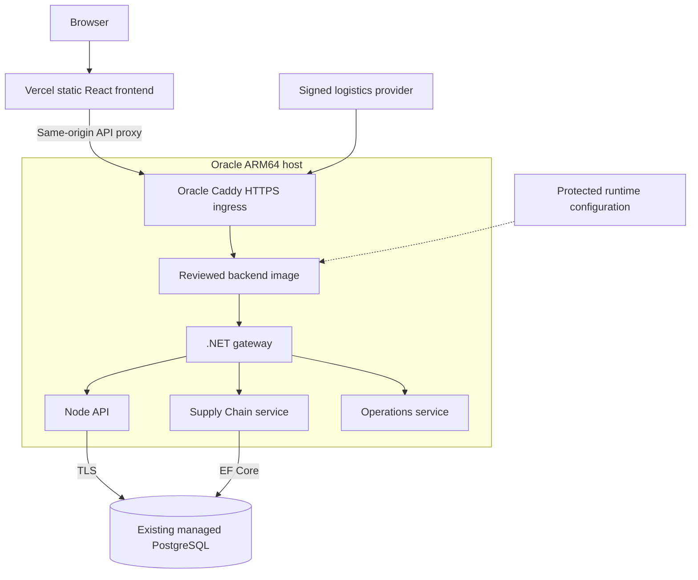
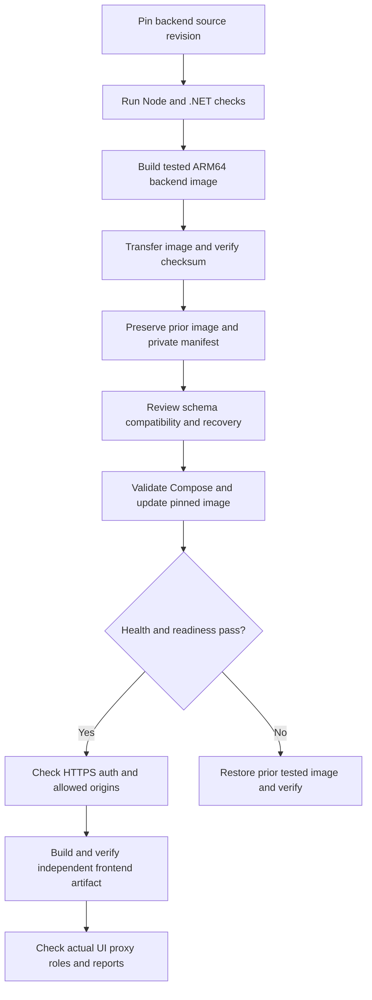

# IMSOP Deployment Guide

The current deployment serves the React frontend from Vercel and runs the Node API and .NET services in a single reviewed ARM64 image on Oracle. PostgreSQL remains a managed external service. This visual guide summarizes the source runbook; commands run in the IMSOP repositories, not in the portfolio.

## Deployment map



Only HTTPS ingress is public. The Compose runtime keeps internal service ports private; the diagnostic bind is loopback-only. The former Render service is suspended and is not the current release target.

## Local setup

Use the frontend and backend repositories side by side. Follow their current toolchain and lockfiles. Create local configuration from the checked-in examples and use a disposable PostgreSQL database.

```bash
# Backend repository: complete local topology
# Review and configure the checked-in environment examples first.
docker compose up -d --build
curl --fail http://127.0.0.1:8080/ready

# Frontend repository, separate terminal
pnpm install --frozen-lockfile
pnpm dev
```

For a standalone Node API, start a local PostgreSQL instance, configure its private connection, and run the Node migration task before `pnpm -C server dev`. Development seed/reset scripts are for disposable databases only. Earlier README instructions for MySQL are historical; the current schema is PostgreSQL.

## Configuration boundaries

| Location | Configuration |
| --- | --- |
| Frontend build | Public API-origin/base-path settings and optional referrer-restricted Maps key |
| Backend runtime | PostgreSQL connection, JWT secret, exact frontend origins, reset URL, email provider settings |
| Provider integration | Separate high-entropy signing secret per logistics provider |
| Oracle host | Tested immutable image tag, private runtime override, ingress configuration |

Keep database, JWT, SMTP, and webhook credentials out of browser variables and Git. The Oracle runbook uses a protected untracked runtime override; validate Compose without printing resolved secrets. Do not replace that file during routine image updates.

## Release sequence



Run backend checks from its checkout:

```bash
pnpm -C server test
pnpm -C server build
dotnet test src/IMSOP.sln -m:1
```

Run frontend tests, build, and browser checks from its checkout. The frontend's `verify:deployment` check rejects retired backend origins in compiled chunks. Pin an immutable backend image rather than a moving `latest` tag. Build with the Oracle Dockerfile and `linux/arm64`; the detailed runbook specifies image transfer and private Compose commands.

## Verification

| Check | Evidence to record |
| --- | --- |
| Liveness and readiness | `/health` and `/ready` through Oracle ingress and the actual UI route |
| Authentication | Real test-account session, secure cookie, anonymous rejection, and logout |
| Authorization | Allowed and denied roles; same-account profile rules |
| Operations | Shipment/order reads, locations, and permitted report exports |
| Integration | Synthetic signed event, replay response, and matching shipment update |
| Frontend | Correct API origin, mobile navigation, and explicit error handling |

Demo login tests exercise the mock-auth path; they do not replace real backend checks. Do not create production users or mutate production shipments merely to demonstrate deployment.

## Rollback and recovery

Retain the previous tested image, manifest, ingress configuration, and protected runtime settings. Restore the prior image tag through the documented Compose update and verify readiness before restoring traffic. Database changes require a separately reviewed compatibility or restore plan; rolling back an image does not reverse migrations.

A shared Oracle VM is a single host failure domain. Define the actual recovery point and recovery time objectives, verify provider backup options, and rehearse a restore in an isolated environment. Emergency return to Render is a separate explicit operation in the source runbook, not the default image rollback.

## References

- [Oracle deployment and rollback runbook](https://github.com/DruHustle/imsop-app-backend/blob/main/deploy/oracle/README.md)
- [Backend deployment reference](https://github.com/DruHustle/imsop-app-backend/blob/main/docs/DEPLOYMENT.md)
- [System diagrams](system-diagrams.md), [architecture](architecture.md), and [database schema](database-schema.md)

Source review: 21 October 2026. This documentation update does not deploy an application.
