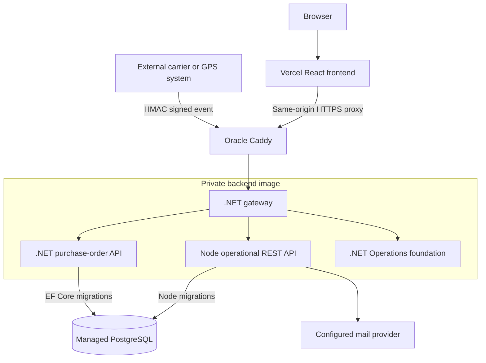
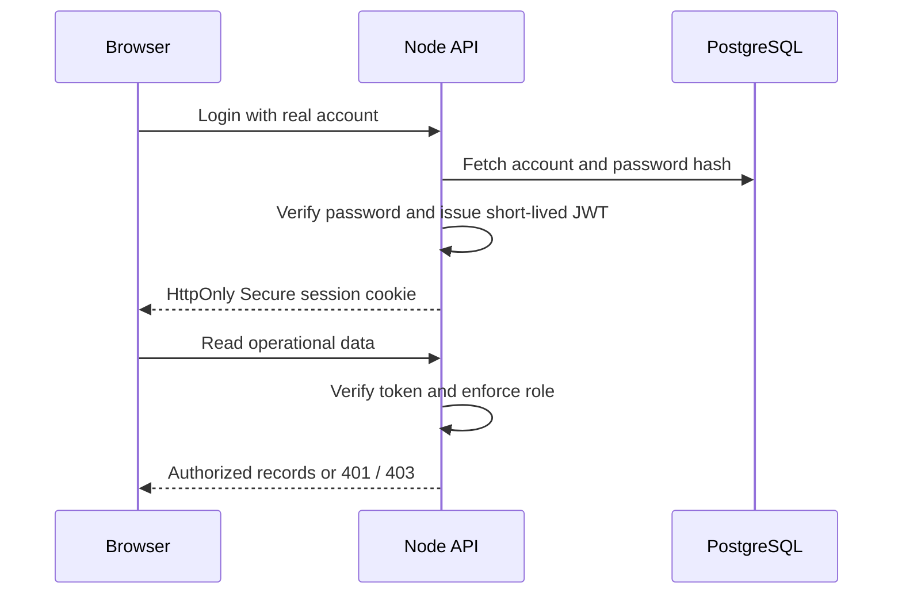
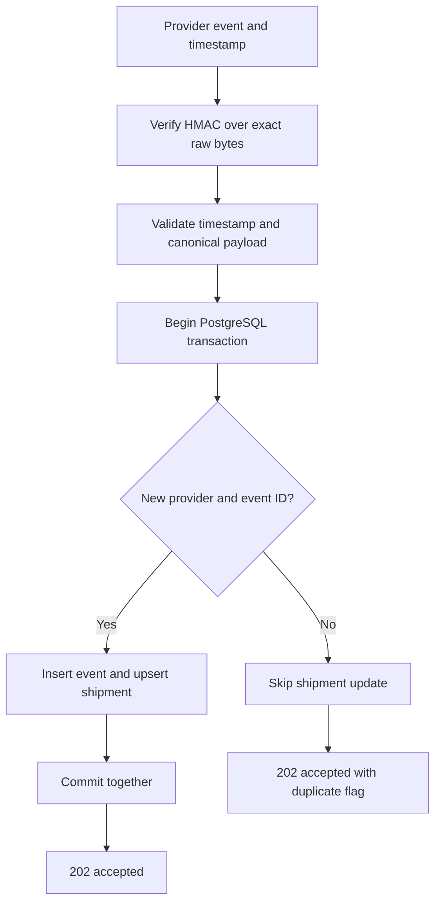
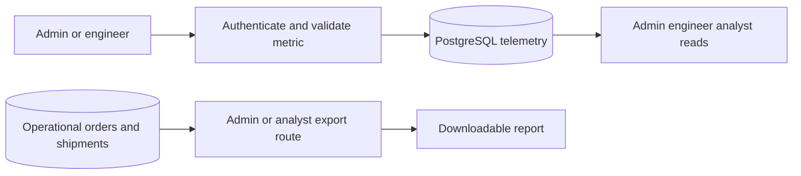
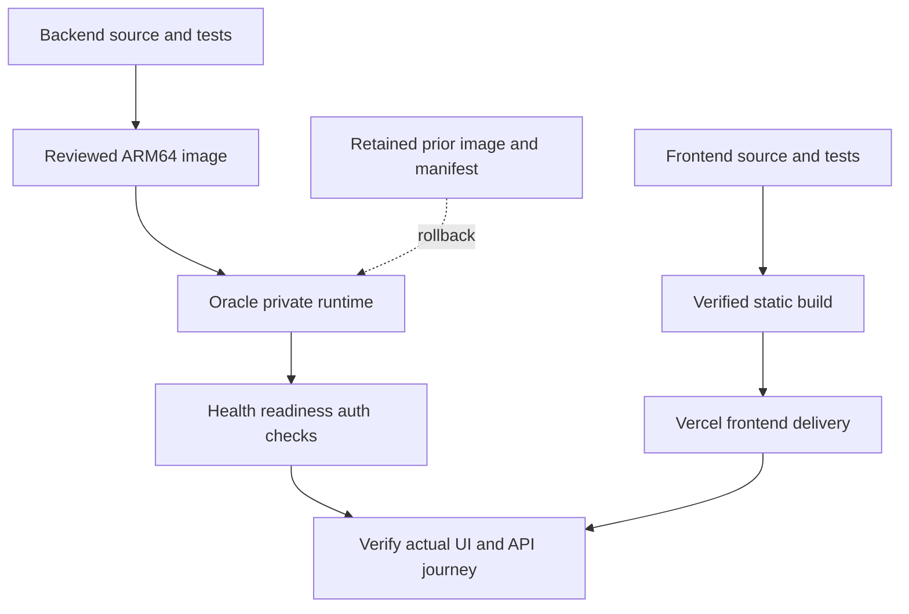

# IMSOP System Diagrams

These rendered diagrams explain current runtime boundaries and source-backed request flows. Solid lines indicate implemented routing or data paths; the optional companion-service model is described explicitly rather than assumed active in every browser workflow.

## 1. Runtime and trust boundaries

Browser operations use the Node API. The gateway and .NET service foundation are packaged alongside it. A deployment template for an Azure dependency is not evidence that the live application uses it. Caddy terminates HTTPS and internal service ports remain private.

## 2. Real-account authentication

Demo authentication is a separate browser adapter. The real-account flow verifies token issuer, audience, expiry, and role server-side. UI visibility alone does not grant access.

## 3. Logistics event consistency

Idempotency uses a unique provider/event key. A tracking number identifies the shipment. The handler does not order events by occurrence time, so late events need integration-level handling.

## 4. Telemetry and reporting

Telemetry uses authenticated REST ingestion; it does not imply a commissioned MQTT or factory-control connection. Samples use server storage timestamps, while logistics records retain provider occurrence and API receipt timestamps.

## 5. Independent release and recovery

Backend updates are manual and independent from frontend releases. Restore a compatible tested image on failed acceptance; recover incompatible database changes through a separate restore plan.

## Related references

- [Architecture overview](architecture.md)
- [Database relationships](database-schema.md)
- [API sequences and endpoint roles](api-flows.md)
- [Visual deployment guide](deployment.md)
- [Oracle source runbook](https://github.com/DruHustle/imsop-app-backend/blob/main/deploy/oracle/README.md)

Source review: 21 October 2026.
