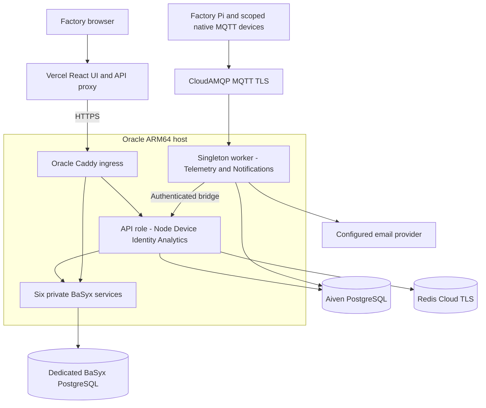
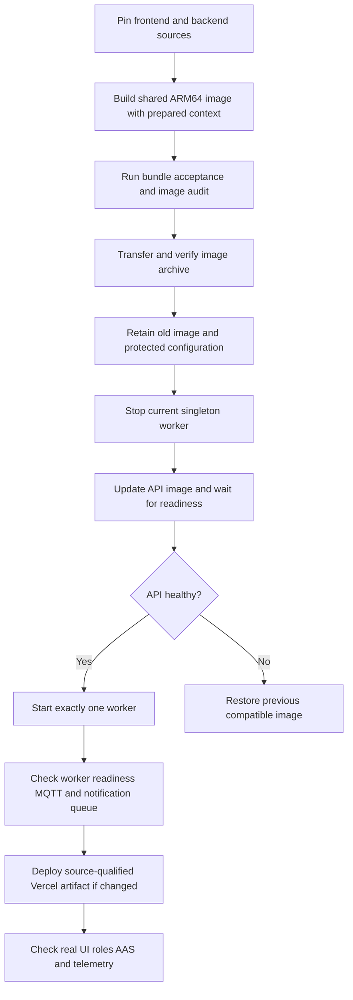

# Smart Factory Deployment Guide

The React frontend runs on Vercel. The current backend runs on Oracle as separate API and singleton worker containers from one reviewed ARM64 image, alongside the separately managed BaSyx stack and Caddy ingress. PostgreSQL, Redis, and MQTT retain their managed providers. The previous Render services are suspended.

## Deployment map



The API role contains Node, DeviceService, IdentityService, and AnalyticsService. The worker role contains TelemetryService and NotificationService. `RENDER_SERVICE_ROLE` remains the role variable for image compatibility; its name does not identify the current hosting provider. Internal service and diagnostic ports remain private or loopback-only.

## Local development

Keep the frontend, backend, and edge repositories side by side. Use Docker Compose v2, the repositories' pinned Node/pnpm versions, Python 3.11, and .NET 8 where needed. Configure ignored `.env.local` files from the supplied examples, using synthetic accounts and local dependencies.

```bash
# Frontend repository: local dashboard, PostgreSQL, Redis, and AAS profile
docker compose --env-file .env.local --profile aas up --build -d --wait

# Backend repository: private .NET services
docker compose --env-file .env.local up --build -d --wait
```

Match the intended service tokens between these local stacks and set `BACKEND_DEPLOYMENT_MODE=compose`. Local physical-device checks require the appropriate broker subscription configuration; a default local RabbitMQ consumer does not receive a physical Pi's CloudAMQP messages automatically.

## Runtime configuration boundaries

| Boundary | Configuration and constraints |
| --- | --- |
| Browser build | Public frontend routing only; no database, MQTT, AAS, or AI service secrets |
| API role | Dashboard database, Redis, session signing, service tokens, AAS OAuth, exact allowed origins |
| Worker role | Telemetry database, stable MQTT client ID, scoped broker credentials, service tokens, API origin, mail settings |
| BaSyx stack | Independent component URLs, OIDC client credentials, dedicated database, and private component ports |
| Edge | Local allowlists, commissioned protocol mappings, scoped MQTT identities, and durable spool |

Use verified TLS for PostgreSQL, Redis, and cloud MQTT. Keep `.env.api` and `.env.worker` protected and untracked; the Oracle Compose raw env-file mode requires Compose 2.30 or newer. Preserve literal credentials during transfer without printing resolved configuration.

## Image update sequence



Build from the frontend checkout with the prepared backend context and `linux/arm64`, then run the repository's bundle smoke and container-audit scripts. Transfer the tested image and preserve the installed configuration. Backend image updates use the manual Oracle procedure; the current Vercel workflow deploys a source revision only after its matching main CI succeeds.

Do not run multiple production workers with the same stable MQTT consumer identity. During any provider rollback, stop the active worker before starting its replacement. Routine updates do not replace the private environment exports or create new databases.

## Health and acceptance

| Check | Purpose |
| --- | --- |
| API `/health/live` | API process liveness |
| API `/health/ready` | Dashboard database, Redis, and required private services |
| Worker readiness and Supervisor state | Telemetry readiness plus both worker processes |
| Real account through Vercel | Secure session cookie, role delegation, logout, allowed and denied actions |
| AAS component descriptions | Authenticated access to all six BaSyx components |
| Commissioned telemetry path | Fresh device values, correct gateway attribution, stable session, draining queues |
| Notifications | Durable inbox and configured provider state; acceptance is not confirmed mailbox delivery |

Use simulated equipment for ordinary acceptance. Hardware commissioning and physical-motion verification are separate site activities. Configuration acknowledgements, broker publication, and controller serial acknowledgements are different events and must not be treated as proof of machine motion.

## Rollback and recovery

Retain the last accepted image, ingress configuration, and protected runtime settings. Restore a compatible backend image, verify API readiness, and start one worker. Restore the previous Vercel artifact if its proxy or contract changed. Schema rollback or database restoration requires its own reviewed plan.

Managed PostgreSQL holds application state; Redis Pub/Sub is transient transport. Edge spools and the telemetry outbox support retry after interruption. Monitor backlog, spool capacity, database pools, and failed notification jobs. A shared Oracle host is one failure domain and does not establish high availability.

## Source runbooks

- [Current Oracle API and singleton-worker runbook](https://github.com/DruHustle/smart-factory-iot-frontend/blob/main/deploy/oracle/README.md)
- [BaSyx runtime](https://github.com/DruHustle/smart-factory-iot-backend/tree/main/deploy/oracle-basyx)
- [Architecture](architecture.md), [API flows](api-flows.md), and [system diagrams](system-diagrams.md)

Source review: 21 October 2026. The portfolio guide documents the release process and does not perform a deployment.
