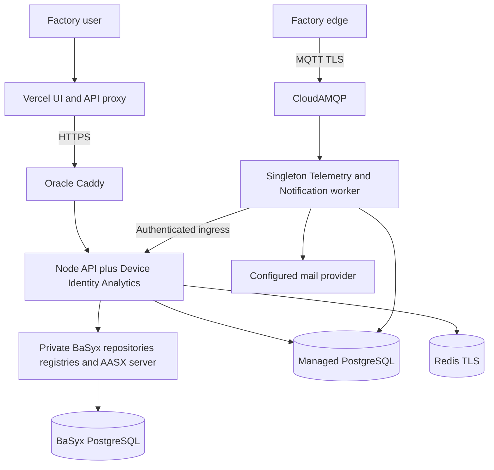
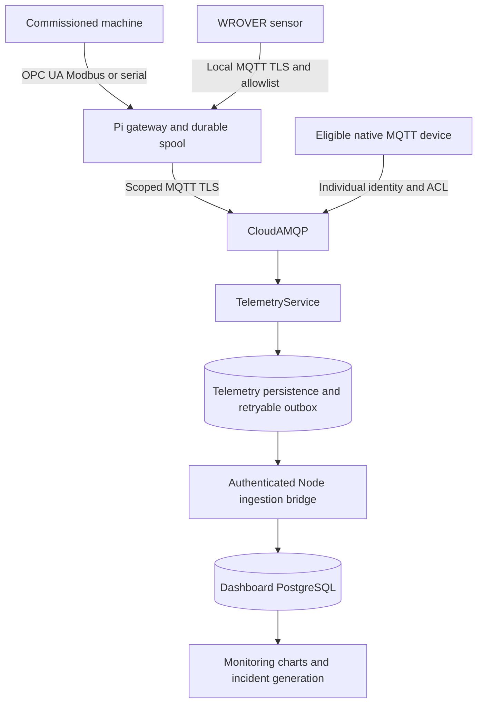
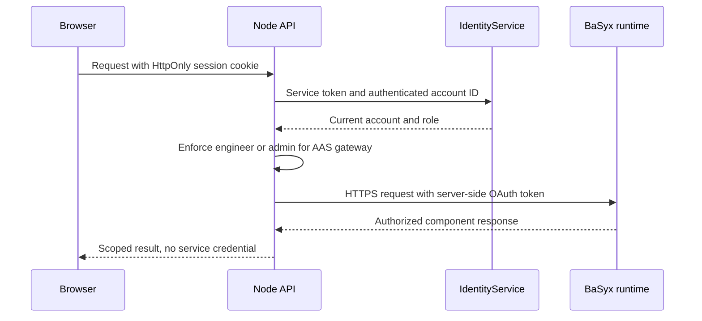
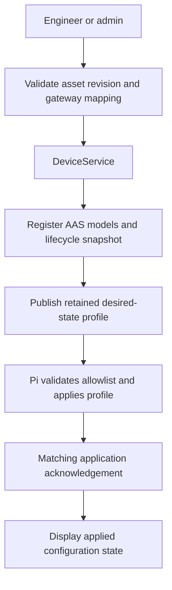
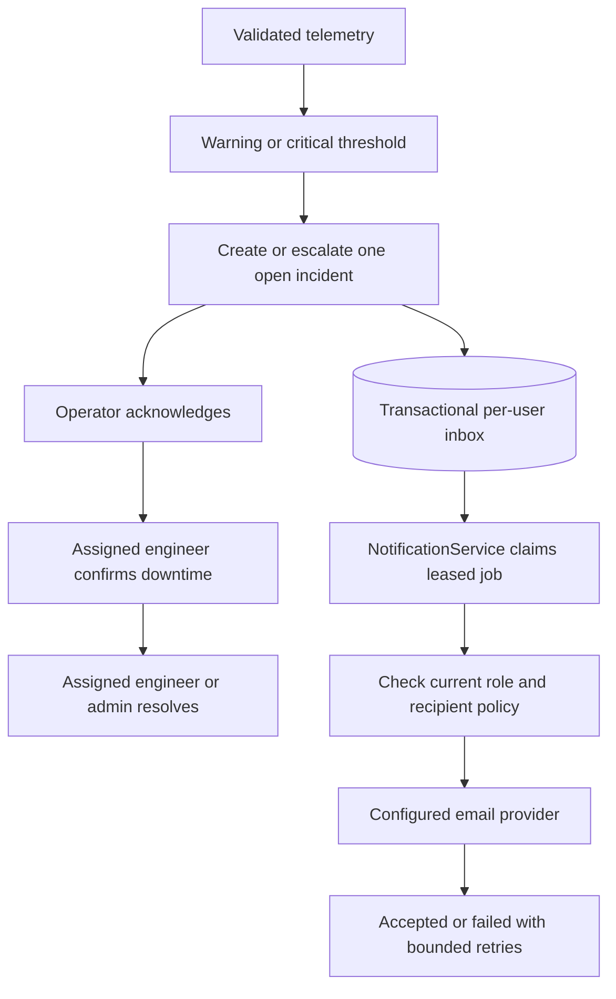
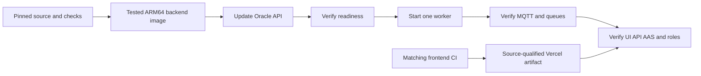

# Smart Factory IoT System Diagrams

These visual flows show application, factory edge, service identity, and persistence boundaries. They complement the detailed architecture and API references.

## Related guides

- [Architecture](architecture.md)
- [API flows](api-flows.md)
- [Database relationships](database-schema.md)
- [Assistant boundaries](assistant.md)
- [Current Oracle source runbook](https://github.com/DruHustle/smart-factory-iot-frontend/blob/main/deploy/oracle/README.md)

Source review: 21 October 2026.

## 1. Current runtime

API and worker roles share one reviewed backend image on Oracle. The six BaSyx services retain their own configuration and data boundary. Render is a historical hosting path; it is not the current production tier.

## 2. Durable telemetry

WROVER and serial controllers stay behind the Pi. Eligible native MQTT devices can use a direct path with individual credentials. A transient Redis notification is not a durable telemetry record. Publication acknowledgement and application persistence are separate checkpoints.

## 3. Identity and AAS access

Application identity and AAS service identity are distinct. Service credentials never grant a browser role. Form-managed AAS changes go through the versioned application workflow so direct standards writes cannot bypass revision history.

## 4. Asset configuration and acknowledgement

QoS 1 publication does not establish that a gateway applied the profile. A configuration acknowledgement does not establish firmware installation or physical movement. Equipment controls require commissioned protocol adapters and remain separate from protective safety functions.

## 5. Incidents and durable notifications

Connectivity loss alone does not start production downtime. Notification read state and incident acknowledgement are separate. Provider acceptance is not proof of mailbox delivery.

## 6. Release flow

See the [visual deployment guide](deployment.md) for configuration, rollout, and rollback. Backend updates are currently manual; the frontend workflow waits for matching source CI.
