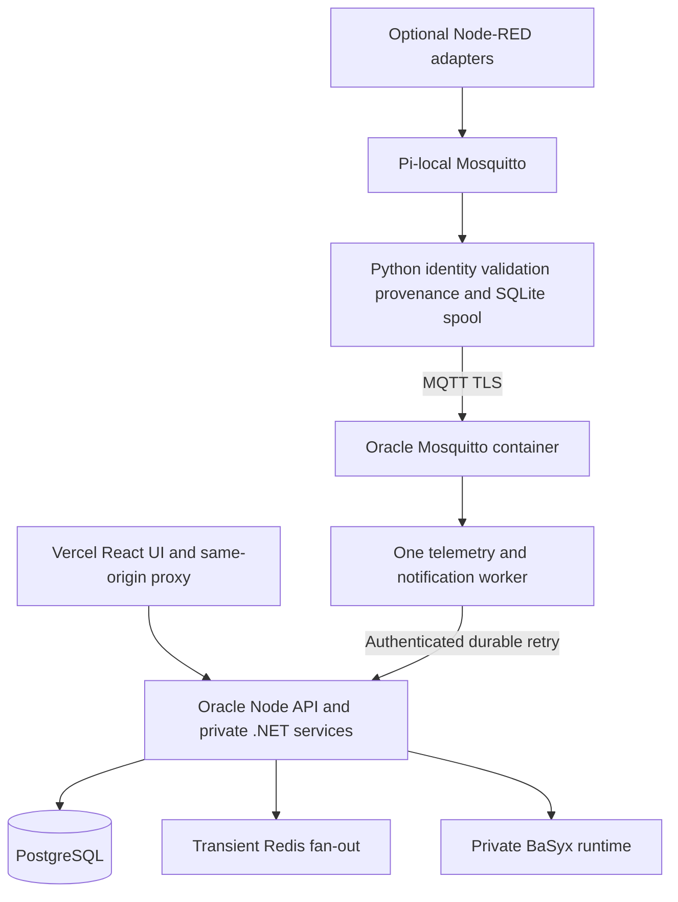

# Smart Factory Deployment Guide

## Current edge and broker responsibilities

Source review: **6 November 2026**, canonical Smart Factory commit `52b4e4207cb7ceb27f419a3548887e63094d83af`. The current [Raspberry Pi gateway guide](https://github.com/DruHustle/smart-factory/blob/52b4e4207cb7ceb27f419a3548887e63094d83af/smart-factory-edge/raspberry-pi/README.md) specifies **local Mosquitto on the Pi and production Mosquitto in a separate Oracle VM container**. Older backend diagrams and staging runbooks contain superseded broker-provider references; the current edge guide and source-specific configuration take precedence. This documentation review is not a new inspection of the VM or physical commissioning.

| Component | Responsibility and limits |
| --- | --- |
| Node-RED (optional) | Protocol/vendor adapters and transformations. Per-source commissioning and publish-only local broker ACLs; no cloud credentials or actuator authority. Existing native Python drivers remain available. |
| Python identity and validation | Check allowed source/topic, schema, types, units and timestamps. Stamp gateway provenance; reject spoofed integration claims and preserve unverified/bad quality until approved. |
| Python durable delivery | Persist accepted observations in SQLite before acknowledging eligible local messages; retry across restarts/outages with original timestamps. Remove upstream QoS 1/2 entries only after the corresponding broker handshake. This is not an end-to-end exactly-once guarantee. |
| Python command policy | Enforce authorized, commissioned targets and command expiry/replay protection. Safety interlocks and manual override stay at the machine. An acknowledgement is not physical feedback. |
| Python cybersecurity | Optional read-only SecurityCollector with an independent durable HTTPS path for identity, configuration, transport and certificate evidence. Disabled until its namespace/token is commissioned. |
| Python AI | Read-only AI advisory capability is in active development. Development status does not establish enabled production inference; any AI component remains subject to source authorization and command policy. |
| Oracle Mosquitto and worker | TLS, dedicated credentials and scoped topics. The .NET worker independently persists/validates telemetry and retries application-API delivery. Redis is transient fan-out, not the durable telemetry record. |

Direct MQTT devices need separate credentials, network reachability and device ACLs. The current Pi-only broker policy does **not** enable them. Node-RED and Python do not replace safety-rated controller functions. See [Node-RED commissioning and Python security/AI scope](https://github.com/DruHustle/smart-factory/blob/52b4e4207cb7ceb27f419a3548887e63094d83af/smart-factory-edge/deploy/node-red/README.md).

## Runtime boundaries

## Configuration and release

Keep gateway, local sensor, worker and application identities separate. Node-RED receives only per-source local publish rights. The central broker uses TLS with hostname verification, dedicated credentials, topic ACLs and persistent storage. A native MQTT device is not authorized merely because software supports that path.

Qualify an immutable application revision with its migrations, API compatibility, singleton-worker receipt, backup and rollback evidence. Install API changes before the matching worker, and never run duplicate consumers with the same persistent identity. The historical RENDER_SERVICE_ROLE variable is a compatibility identifier, not evidence of Render hosting.

Deployments and provider changes are not performed by visiting this portfolio. No credentials, internal endpoints or farm/factory device settings belong in the public documentation. Kubernetes manifests alone do not establish a running cluster.

## Verification and rollback

Test local identity rejection, invalid/stale payloads, queue-full handling, process restart, TLS reconnect, duplicate deliveries and original timestamp preservation. Check worker persistence separately from broker receipt. For any authorized physical command, validate expiry, replay rejection, manual override and observed feedback at the installation. Retain known-good runtime settings and queues for rollback.

## Source references

- [Current gateway and broker](https://github.com/DruHustle/smart-factory/blob/52b4e4207cb7ceb27f419a3548887e63094d83af/smart-factory-edge/raspberry-pi/README.md)
- [Consolidated release gates](https://github.com/DruHustle/smart-factory/blob/52b4e4207cb7ceb27f419a3548887e63094d83af/docs/consolidated-release.md)
- [Oracle deployment runbook](https://github.com/DruHustle/smart-factory/blob/52b4e4207cb7ceb27f419a3548887e63094d83af/smart-factory-frontend/deploy/oracle/README.md)
