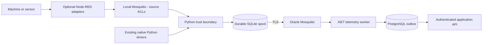
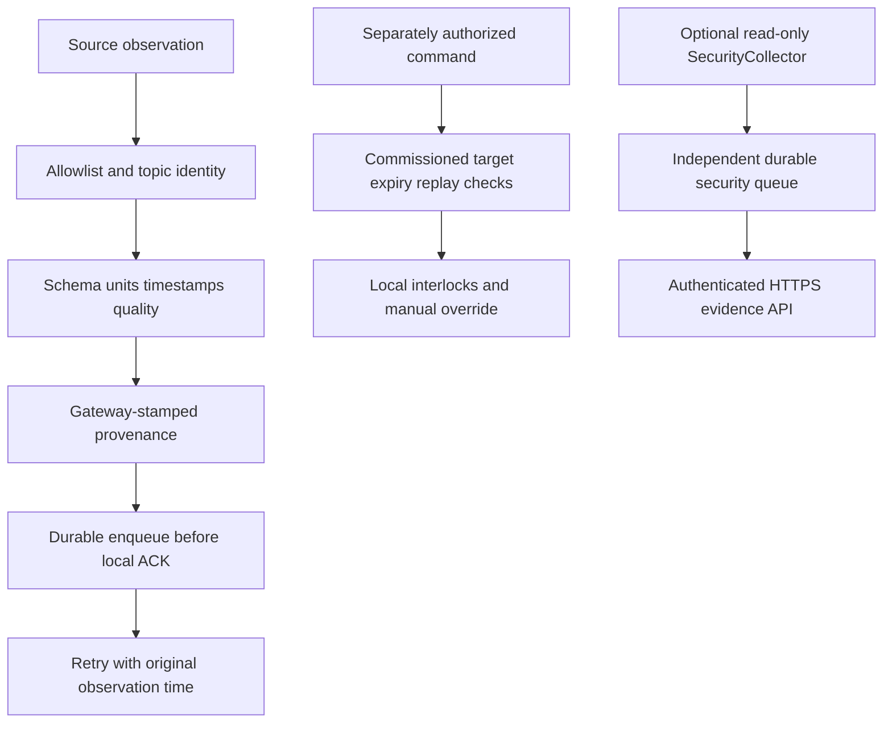

# Smart Factory System Diagrams

## Current edge and broker responsibilities

Source review: **6 November 2026**, canonical Smart Factory commit `52b4e4207cb7ceb27f419a3548887e63094d83af`. The current [Raspberry Pi gateway guide](https://github.com/DruHustle/smart-factory/blob/52b4e4207cb7ceb27f419a3548887e63094d83af/smart-factory-edge/raspberry-pi/README.md) specifies **local Mosquitto on the Pi and production Mosquitto in a separate Oracle VM container**. Older backend diagrams and staging runbooks contain superseded broker-provider references; the current edge guide and source-specific configuration take precedence. This documentation review is not a new inspection of the VM or physical commissioning.

| Component | Responsibility and limits |
| --- | --- |
| Node-RED (optional) | Protocol/vendor adapters and transformations. Per-source commissioning and publish-only local broker ACLs; no cloud credentials or actuator authority. Existing native Python drivers remain available. |
| Python identity and validation | Check allowed source/topic, schema, types, units and timestamps. Stamp gateway provenance; reject spoofed integration claims and preserve unverified/bad quality until approved. |
| Python durable delivery | Persist accepted observations in SQLite before acknowledging eligible local messages; retry across restarts/outages with original timestamps. Remove upstream QoS 1/2 entries only after the corresponding broker handshake. This is not an end-to-end exactly-once guarantee. |
| Python command policy | Enforce authorized, commissioned targets and command expiry/replay protection. Safety interlocks and manual override stay at the machine. An acknowledgement is not physical feedback. |
| Python cybersecurity | Optional read-only SecurityCollector with an independent durable HTTPS path for identity, configuration, transport and certificate evidence. Disabled until its namespace/token is commissioned. |
| Python AI | Read-only AI advisory capability is in active development. Development status does not establish enabled production inference; any AI component remains subject to source authorization and command policy. |
| Oracle Mosquitto and worker | TLS, dedicated credentials and scoped topics. The .NET worker independently persists/validates telemetry and retries application-API delivery. Redis is transient fan-out, not the durable telemetry record. |

Direct MQTT devices need separate credentials, network reachability and device ACLs. The current Pi-only broker policy does **not** enable them. Node-RED and Python do not replace safety-rated controller functions. See [Node-RED commissioning and Python security/AI scope](https://github.com/DruHustle/smart-factory/blob/52b4e4207cb7ceb27f419a3548887e63094d83af/smart-factory-edge/deploy/node-red/README.md).

## Acquisition and trusted delivery

## Python policy boundaries

## Evidence interpretation

A broker receipt is not database persistence, a command receipt is not physical feedback, and an offline connection is not confirmed production downtime. Missing clocks, stale values and uncommissioned sources remain explicit. The browser Assistant and Python AI capability in active development are distinct; neither has implicit control authority.

## Independent applications

Smart Logistics and Smart Farmer have their own Node-RED/Python, identities, storage and policies. Their documented Python observation paths send signed HTTPS, not Smart Factory's MQTT uplink. Farmer's optional Python path has no remote-start/stop API; its equipment/camera gateways are separate.
